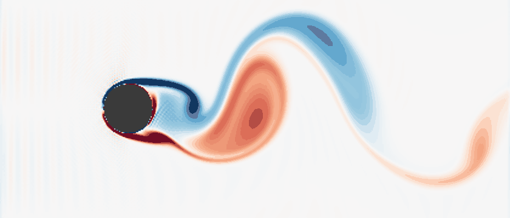
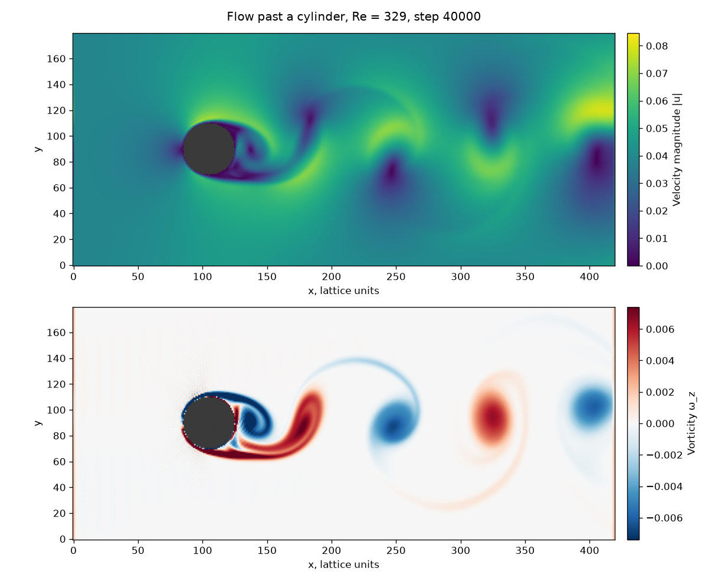
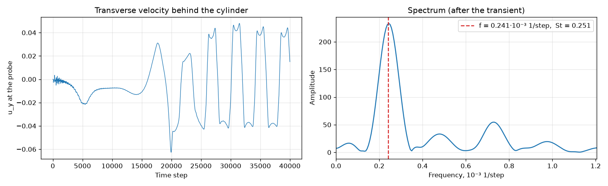

# Решёточный метод Больцмана: обтекание цилиндра

[](https://github.com/yndarra/lbm-simulation/actions/workflows/tests.yml)


[English](README.md) | **Русский**

Векторизованная реализация **решёточного метода Больцмана (LBM)** на решётке
D2Q9 на NumPy. Моделируется обтекание кругового цилиндра в канале: за
цилиндром образуется **вихревая дорожка Кармана**, и по ней измеряется частота
схода вихрей (число Струхаля).

<p align="center">
  
</p>
<p align="center"><sub>Завихренность, шаги с 20 000 по 40 000. Красный — вращение против часовой стрелки, синий — по часовой.</sub></p>

> Лабораторная работа по дисциплине «Компьютерное моделирование».

## Метод

LBM не решает уравнения Навье–Стокса напрямую. Вместо этого он моделирует
кинетику условных частиц: в каждом узле решётки хранятся 9 функций
распределения `fᵢ`, по одной на каждую дискретную скорость `cᵢ` (покой, 4
соседа по осям и 4 по диагоналям). Шаг по времени состоит из двух операций:

1. **Столкновение** (BGK, одно время релаксации): `fᵢ ← fᵢ − ω·(fᵢ − fᵢᵉᑫ)`
2. **Перенос**: каждая `fᵢ` переходит в соседний узел вдоль `cᵢ`

Плотность и скорость — моменты распределений: `ρ = Σ fᵢ`, `ρu = Σ fᵢcᵢ`.
Вязкость задаётся через число Рейнольдса: `ν = u·r / Re`, `ω = 1 / (3ν + ½)`.

| Граница | Условие |
|---|---|
| Вход (слева) | Заданная скорость, схема Зоу–Хе |
| Выход (справа) | Нулевой градиент для неизвестных входящих распределений |
| Сверху и снизу | Периодические |
| Цилиндр | Отражение (bounce-back), условие прилипания |

На входную скорость наложено крошечное синусоидальное возмущение `10⁻⁴`. Без
него поток идеально симметричен, и вихревая дорожка появилась бы гораздо
позже — только от ошибок округления.

### Отличия от исходной версии

* **Исправлена ошибка на входе.** В условии Зоу–Хе диагональные входящие
  распределения были сопоставлены не с теми исходящими направлениями, из-за
  чего на входе нарушался баланс импульса. Теперь пары строятся по явной
  таблице `OPPOSITE`, и это проверяет юнит-тест.
* **Примерно в 2.4 раза быстрее.** Шаг на сетке 420 × 180 занимает около 10 мс
  вместо 24 мс. Помогли раскладка массивов `(9, nx, ny)`, векторизованное
  равновесие и отражение только в узлах препятствия.
* **Гораздо меньше данных.** Исходный ноутбук сохранял поля в три файла `.npy`
  по 240 МБ. Теперь сохраняются только кадры завихренности и сигнал датчика —
  сжатый `.npz` около 1 МБ.

## Результаты

Параметры по умолчанию — вариант 20 задания:

| Параметр | Значение |
|---|---|
| Сетка | 420 × 180 |
| Цилиндр | центр (105, 90), радиус 20 |
| Скорость на входе `u` | 0.0384 (в решёточных единицах) |
| Число Рейнольдса (по радиусу) | 329 |
| Релаксация `ω` | 1.972 |
| Шагов | 40 000 (6.6 мин на CPU ноутбука) |



Первые ~15 000 шагов след остаётся симметричным. Затем он теряет
устойчивость, и с верхней и нижней сторон цилиндра попеременно начинают
срываться вихри противоположного знака.



Поперечная скорость `u_y` в датчике на два диаметра ниже по потоку колеблется
с периодом **≈ 4150 шагов**. Отсюда число Струхаля

```
St = f·D / U ≈ 0.25
```

Это близко к классическому значению около 0.2 для цилиндра. Немного больше оно
здесь, как и следует ожидать, потому что область периодична по `y`. Поток
фактически обтекает ряд цилиндров, стоящих всего в 4.5 диаметра друг от друга,
и такое стеснение ускоряет течение вокруг каждого. В окно усреднения
помещается всего четыре полных периода, поэтому оценка грубая.

## Запуск

```bash
git clone https://github.com/yndarra/lbm-simulation.git
cd lbm-simulation
python -m venv .venv
.venv/Scripts/activate        # Windows; в Linux/macOS: source .venv/bin/activate
pip install -r requirements.txt

python main.py run            # расчёт и сохранение data/run.npz (≈ 7 мин)
python main.py plot           # картинки по сохранённым данным
python main.py                # оба шага
python main.py run --variant 10 --steps 60000
```

Тесты:

```bash
pip install -r requirements-dev.txt
pytest
```

Тесты проверяют веса и противоположные направления D2Q9, моменты равновесного
распределения, а также то, что короткий расчёт устойчив, почти несжимаем и
даёт след за цилиндром.

## Структура проекта

```
lbm/
├── solver.py         # решётка D2Q9, равновесие, FlowParams, CylinderFlow
└── visualization.py  # поля, спектр сигнала датчика, GIF завихренности
tests/                # тесты решётки и решателя
main.py               # точка входа: run / plot
```

## Литература

* T. Krüger et al. *The Lattice Boltzmann Method: Principles and Practice.* Springer, 2017.
* Q. Zou, X. He. *On pressure and velocity boundary conditions for the lattice Boltzmann BGK model.* Phys. Fluids 9, 1591 (1997).
* [Пример cylinder из Palabos](https://palabos.unige.ch/) — классическая эталонная постановка этой задачи.

## Лицензия

[MIT](LICENSE)
